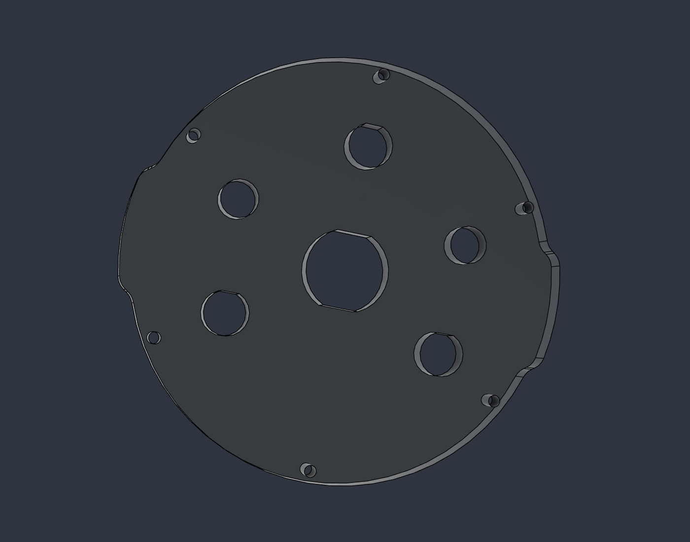

# Quarter-inch acrylic endcap — LP20 fit study

This endcap layout targets 6.35 mm acrylic with three motor connectors, Ethernet, a depth-sensor port and a vacuum/pressure-relief port. Physical fitting checks and pressure qualification remain pending.

Current exports: [SVG](Endcap_6p35_LP20_fit_layout.svg), [DXF](Endcap_6p35_LP20_fit_layout.dxf), [STEP](Endcap_6p35_LP20.step). No kerf compensation is included. Cut the [LP12 coupon](LP12_6p35mm_fit_coupon.svg) and [LP20 coupon](LP20_6p35mm_fit_coupon.svg) in actual stock first.

- Thickness: 6.35 mm; original perimeter and six 3.2 mm fixing holes retained.
- Three LP12 openings: single-flat D, underlying diameter 12.10 mm and overall height 11.60 mm.
- Two M10 clearance openings: 10.20 mm each, for Bar02 and PRV/vacuum.
- One LP20 opening: double-flat, underlying diameter 22.60 mm and 20.50 mm across flats.
- Total cutting contours: one perimeter, six fixing holes, six main openings = 13 closed contours.

LP12 coupon left/middle/right: diameter/height 12.00/11.50, 12.10/11.60, 12.20/11.70 mm. LP20 coupon left/middle/right: diameter/across-flats 22.50/20.40, 22.60/20.50, 22.70/20.60 mm. Each coupon is 100 × 35 mm.

The LP20 fitting was selected after considering M20 and LP16 options. This layout replaces the earlier drawings that omitted the Ethernet opening. The selected LP20 mounting thread length and allowable panel thickness are not specified in the available drawing: physically check seal seating, nut engagement and tool clearance through the 6.35 mm plate. Do not enlarge holes or counterbore the pressure plate merely to force a fitting to fit.

One-solid, thickness, contour and analytic-volume checks passed. Those checks do not establish acrylic strength, watertightness or depth capacity. The referenced LP20 specification states IP68 at 2 m for 48 hours; it does not establish 20–50 m use. Reducing the original 12.7 mm blank to 6.35 mm and adding ports requires separate structural and pressure qualification. The assembly's flange/seal interface remains to be checked.

Sources: LP12 and LP20 mechanical drawings for the selected fittings; [Bar sensor guide](https://bluerobotics.com/learn/bar-sensors-guide/); [Blue Robotics PRV](https://bluerobotics.com/store/watertight-enclosures/enclosure-tools-supplies/prv-m10-asm/). Original screenshots and datasheets are retained locally as design references.
