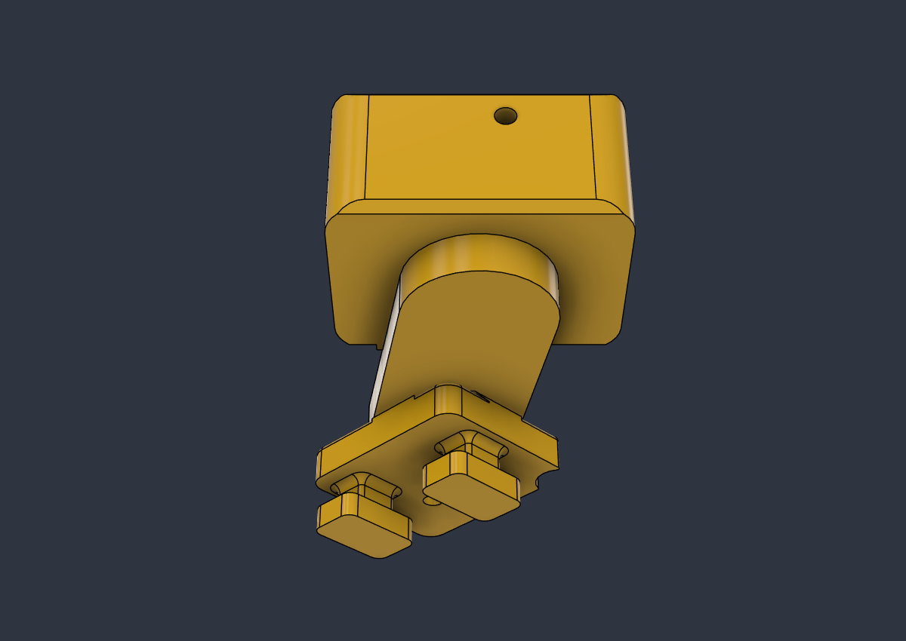

# U01 slide-in rail thruster mounts

Use the seven files in [STL](STL/): four horizontal mounts with continuous smooth supports, two rounded vertical mounts, and a rail-fit coupon. Earlier ribbed supports and removable-jaw designs are superseded. Exports are in assembly coordinates and must be oriented in the slicer.

The integral rail receiver uses nominal 0.3 mm clearance and a 60 mm receiver length. One M4 × 50 mm cross-bolt, one M4 nut and one washer retain each thruster: six of each for six mounts. The supplied rail model has an approximately 5.19 mm transverse hole; check the physical rail, bolt play and retention under reversing loads. Do not tighten the printed receiver until it crushes the rail.

Print the rail coupon first in the intended PETG settings. Check sliding fit, surface finish and play before printing the full set. Channel-end-down is a candidate orientation, but integrated bayonet feet still need local support. These parts are not claimed support-free, sliced or strength-tested.

The four horizontal parts replace the highlighted ribbed span with a 32 mm-wide, 11 mm-thick capsule-shaped support and 1.5 mm exposed upper-side fillets. Receivers have rounded exterior ends; rail contact, bayonet interface and fastener arrangement are retained. The two vertical mounts use the preceding rounded receiver geometry.

The final CAD bodies were single solids with healthy fillets; local interference checks passed. Those checks do not establish physical fit, printed strength or wet-service durability. The original scripts, checks and earlier exports are preserved in the private working-history archive.
