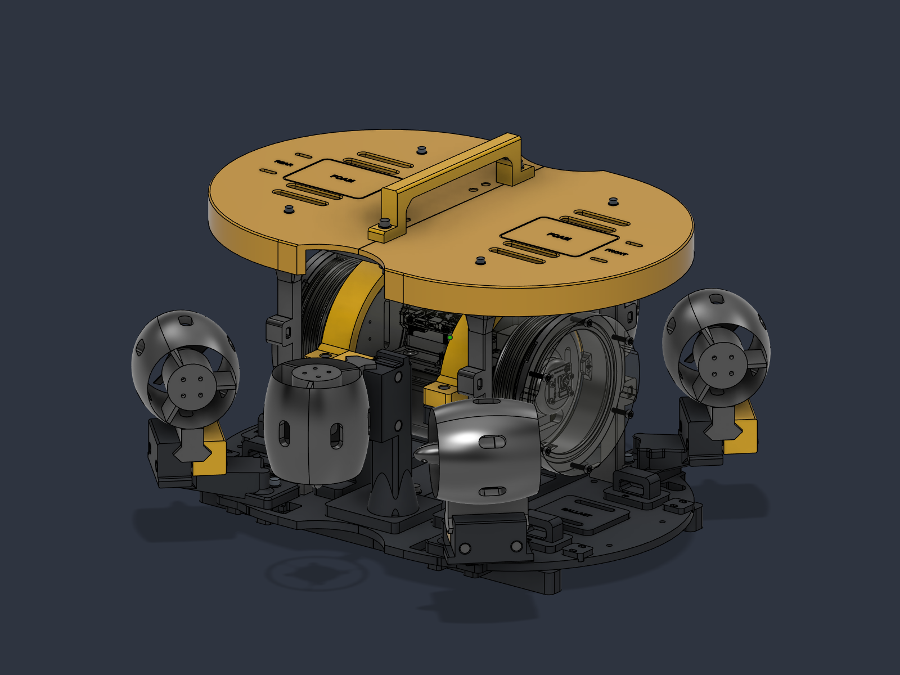

# Club ROV

Club ROV is a six-thruster underwater vehicle for robotics-club training, RoboSub sensor experiments and outreach demonstrations. It combines a modular printed frame, an ARK flight controller running ArduSub, and an ESP32-P4 for camera streaming and Ethernet communication.

[View the detailed assembly in 3D](https://github.com/PrabeshPathak2002/club-rov/blob/main/Models/club-rov-preview.stl) · [New member guide](Documentation/NEW_MEMBERS.md) · [Current status](Documentation/STATUS.md)

The 3D preview shows the September frame revision. Later revisions cover the mounts, battery layout, electronics stack and endcap; those changes are documented under [Hardware](Hardware/README.md) and are not all included in the preview yet.

## System

Vehicle control and communications are split between two boards: the ARK handles stabilization and thruster mixing, while the ESP32 handles video, telemetry transport and maintenance.

- Six APISQUEEN U01 thrusters: four vectored horizontal and two vertical.
- ARK FPV with ArduSub: stabilization, motor mixing and vehicle failsafes.
- Waveshare ESP32-P4-WIFI6-POE-ETH: USB MAVLink bridge, camera video, maintenance dashboard and OTA updates.
- Raspberry Pi Camera V2.1 / IMX219: hardware H.264 video over Ethernet.
- DAKEFPV four-in-one ESC plus two Blue Robotics Basic ESCs.
- Propulsion battery: Zeee 4S 3300 mAh, 132 × 43 × 29 mm nominal. PoE supplies companion electronics; backup power remains to be designed.
- QGroundControl at the surface. ROS 2 Humble on Ubuntu 22.04 supports simulated navigation-sensor experiments; physical ROS autonomy integration remains pending.

## Build, learn and contribute

The build documentation supports learning the design, reproducing the software setup and contributing to the project.

- [Firmware build and source tour](Code/ROV%20ESP32-P4%20code/README.md)
- [Architecture and network setup](Documentation/ARCHITECTURE.md)
- [Electronics and ESC setup](Documentation/ELECTRONICS.md)
- [Current ROV bill of materials](Documentation/BOM.md)
- [Mechanical revisions and fit files](Hardware/README.md)
- [Unity pool simulator](Simulation/ClubROVSim/README.md)
- [ArduSub SITL and Unity setup](Simulation/SITL/README.md)
- [ROS 2 DVL simulation and local odometry](ROS2/README.md)
- [Autonomous dive, return and surface exercise](ROS2/MISSION.md)
- [Camera calibration and prequalification experiments](ROS2/PREQUAL.md)
- [Course learning and sensor-policy tools](ReinforcementLearning/README.md)
- [Runnable first-course sensor policy and measured limits](ReinforcementLearning/Models/README.md)
- [Testing plan](Documentation/TESTING.md) and [bench results](Documentation/STATUS.md)
- [New member learning path](Documentation/NEW_MEMBERS.md)
- [Roadmap](Documentation/ROADMAP.md) and [contribution guide](CONTRIBUTING.md)

## Current software scope

The simulator includes compact sidebar controls, a DVL-estimated path display, tether forces, run review, audio, animated thrusters and adjustable FPV visibility. ROS 2 Humble combines simulated DVL, IMU and pressure measurements, and the external-navigation profile feeds ArduSub SITL for Position Hold and autonomous exercises. Calibration, recording and prequalification tooling are available under `ROS2`.

The delivered sensor-course policy uses a learned landmark estimator, a learned map prior and visual/sensor feedback. Its recorded standard-layout evaluation completed 39 of 40 courses. Its randomized-layout evaluation completed 0 of 20. Earlier PPO experiments with privileged simulator observations are documented separately. These results describe simulated behavior, and physical vehicle integration remains in progress.

The circular five-LP12 rear endcap has been laser-cut. Installed fitting clearance and enclosure testing are pending. See the [hardware revision index](Hardware/README.md) and [physical build status](Documentation/STATUS.md) before fabrication or water testing.
