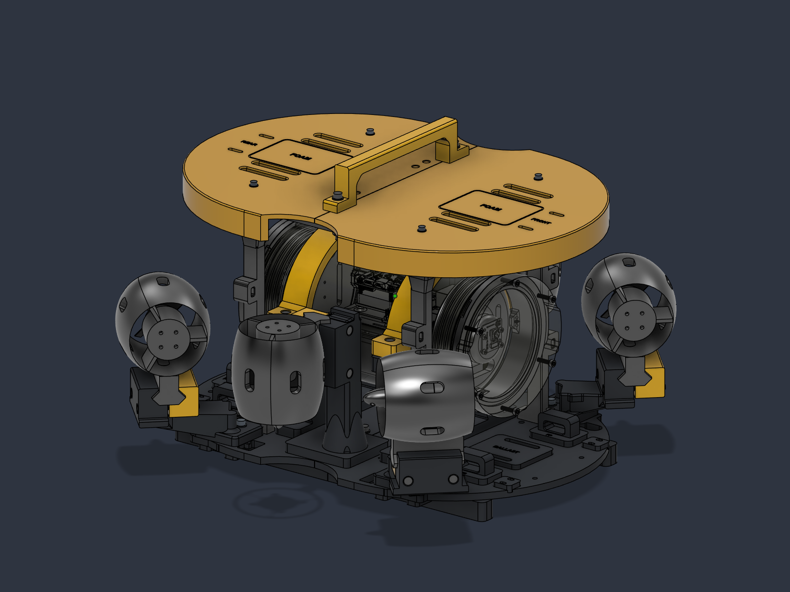

# Club ROV

A six-thruster tethered ROV for teaching underwater robotics, testing sensors for a RoboSub AUV, and club outreach. The project combines a modular printed frame, an ArduSub flight controller, and an ESP32 camera and communications companion.

[View the detailed assembly in 3D](https://github.com/PrabeshPathak2002/club-rov/blob/main/Models/club-rov-preview.stl) · [New member guide](Documentation/NEW_MEMBERS.md) · [Current status](Documentation/STATUS.md)

The assembly preview records the September frame revision. Later mount, battery, stack and endcap revisions are documented separately under [Hardware](Hardware/README.md); they are not all represented in that viewing mesh.

## System

- Six APISQUEEN U01 thrusters: four vectored horizontal and two vertical.
- ARK FPV with ArduSub: stabilization, motor mixing and vehicle failsafes.
- Waveshare ESP32-P4-WIFI6-POE-ETH: USB MAVLink bridge, camera video, maintenance dashboard and OTA updates.
- Raspberry Pi Camera V2.1 / IMX219: hardware H.264 video over Ethernet.
- DAKEFPV four-in-one ESC plus two Blue Robotics Basic ESCs.
- Selected propulsion battery: Zeee 4S 3300 mAh, 132 × 43 × 29 mm nominal. PoE supplies companion electronics; backup power remains to be designed.
- QGroundControl at the surface. ROS 2 Humble on Ubuntu 22.04 is a future integration task.

## Build, learn and contribute

- [Firmware build and source tour](Code/ROV%20ESP32-P4%20code/README.md)
- [Architecture and network setup](Documentation/ARCHITECTURE.md)
- [Electronics and ESC setup](Documentation/ELECTRONICS.md)
- [Current component list](Documentation/BOM.md)
- [Mechanical revisions and fit files](Hardware/README.md)
- [Testing plan](Documentation/TESTING.md) and [recorded bench results](Documentation/STATUS.md)
- [New member learning path](Documentation/NEW_MEMBERS.md)
- [Roadmap](Documentation/ROADMAP.md) and [contribution guide](CONTRIBUTING.md)
