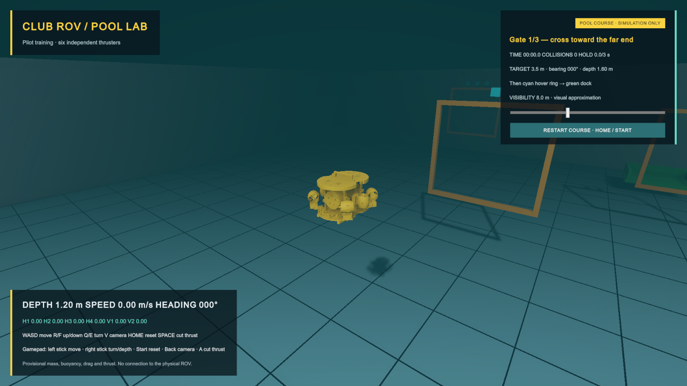
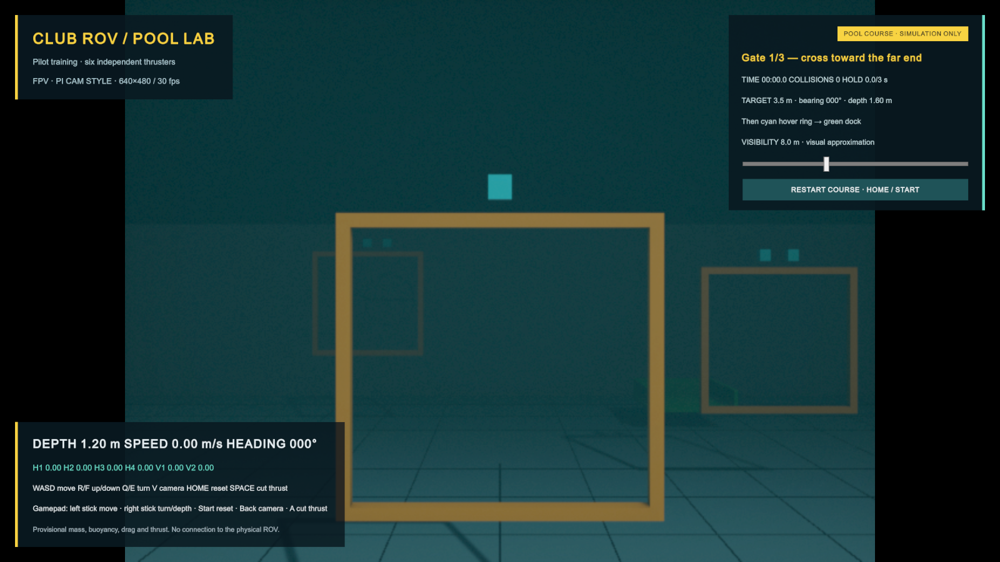
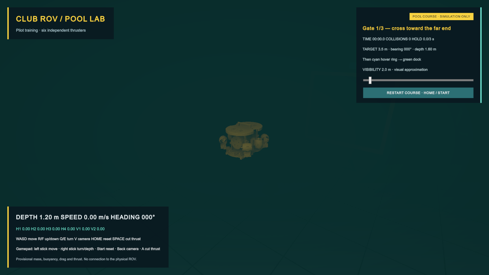

# Club ROV simulator

This Unity simulator provides pool training and sensor experiments for the club ROV. It uses the existing assembly viewing mesh, a six-thruster force model and a 20 × 24 m training pool, 3.5 m deep.

Editor: **Unity 6000.6.7f1**. Render pipeline: **URP 17.6.0**. Input: **Unity Input System 1.20.1**. The approved Unity Pipeline package provides local Editor automation; no cloud project is required.

## Run it

1. Add this folder to Unity Hub as an existing project and open it with the matching Editor.
2. Open `Assets/Scenes/PoolTraining.unity`.
3. Press Play, then click the Game view to give it keyboard/controller focus.

The validated local Windows build is in `Builds/Windows/ClubROVSim.exe`. Keep the entire Windows folder together when copying it. Build output is excluded from Git.

Keyboard controls:

- **W/S:** forward/backward.
- **A/D:** move sideways.
- **R/F:** ascend/descend.
- **Q/E:** turn left/right.
- **V:** cycle Chase → FPV → Top-down.
- **H:** hide/show the entire HUD (controller: right-stick click). Each panel also has a minimize/restore title button.
- **Home:** reset position, orientation, velocity and thruster commands.
- **Space:** cut simulated thrust. The vehicle still has inertia.

Gamepad controls: left stick moves horizontally; right stick controls yaw and vertical thrust; Start resets; Back/Select cycles camera views; A/south button cuts thrust. Synthetic keyboard/gamepad checks verify these mappings, and all controls were confirmed with the connected Xbox Controller in a hands-on test. Losing application focus clears pilot thrust commands.

For tuning, select **Club ROV - simulation** in the Hierarchy and change the **Rov Pilot Input** component in the Inspector before pressing Play. Defaults are **0.15 stick dead zone**, **0.65 translation sensitivity**, **0.50 yaw sensitivity** and **0.60 maximum thrust**. Sensitivity scales the requested motion; the thrust limit caps all mixed actuator forces together to preserve balance. Values changed during Play are temporary. The keyboard uses the same sensitivity and thrust limit, with no stick dead zone.

## FPV camera feed

**V**, controller **Back/Select**, or the HUD's **CAMERA** button cycles Chase, Pi-camera-style FPV and Top-down. The north-up orthographic top-down view follows the ROV and bypasses the FPV effect. Each telemetry/settings panel has a minimize/restore title button. **H** or controller **right-stick click** hides/shows the entire HUD, including all buttons, for an unobstructed view; press the same control to restore it. Panel state lasts for the current Play session. FPV uses **640 × 480**, **4:3 framing** and a **30 fps maximum sample cadence**, with mild softness, darker-area sensor grain, 8-bit color steps and subtle block variation. The HUD stays at native display resolution. Only the camera video is affected; vehicle physics and input continue at their normal rates.

The starter lens uses **48.8° vertical field of view**, based on the standard [Raspberry Pi Camera Module 2 specification](https://www.raspberrypi.com/documentation/accessories/camera.html). This is an appearance preset, not a claim about the real camera's maximum resolution, configured stream, underwater housing optics or measured noise. FPV follows the vehicle's full orientation, including roll and pitch. Camera placement remains the existing forward viewing offset rather than an optical model through the enclosure window.

Select **Main Camera → Rov Fpv Camera Feed** before Play to change resolution, frame rate, lens field of view, noise or softness. Switching back to chase restores its lens and viewport and releases the held video frame. There is no simulated network latency, packet loss or real codec yet; block variation is only an approximation.

## Training course and visibility

Cross the three yellow gates in order, toward the far end of the pool (+Z). The cyan pips above each gate identify its number. Crossing backward or outside the inset opening does not score. The HUD gives the next target's distance, bearing and depth.

After gate 3, hold inside the **cyan hover target** for **3 continuous seconds**, heading **000° ±15°**, at less than **0.15 m/s**. Leaving the 0.45 m target radius, turning too far or moving too fast resets the hold. Then enter the **green docking bay**, heading **180° ±15°**, and remain within 0.40 m horizontally and 0.18 m vertically of its target at less than **0.10 m/s** for **3 seconds**.

The timer starts with movement and freezes on completion. The collision counter records contact entries, with a 0.4 s debounce to avoid counting several contacts from one impact. Contact does not invalidate the run. **Restart Course**, **Home** or controller **Start** resets the vehicle, timer, objectives and collisions. **Space/A** cuts thrust without resetting the course.

Use the HUD's **visibility slider** from **1–20 m**; the default is **8 m**. It controls exponential underwater fog and water tint, with scene contrast reduced to roughly 2% at the selected distance. This is a visual training approximation, not a measured turbidity model. Fog disables above the water surface; no wave, refraction or scattering solver is implemented. The slider and restart button accept mouse input without taking the controller's piloting bindings.

## What the model does

Four angled horizontal thrusters supply surge, sway and yaw. Two vertical thrusters supply heave. Each command becomes a force at an individual body-space position, with a simple response delay and reduced reverse thrust. The rigid body also receives gravity, buoyancy, quadratic linear drag and angular damping. An offset center of buoyancy gives passive roll/pitch stability.

The HUD shows simulated depth, speed, heading and all six normalized thruster-force commands. The horizontal mixer allocates sway, surge and yaw using the measured lever arms and accounts for the weaker reverse limit before applying force. These are force fractions, not PWM/DShot values. H1 is front port, H2 front starboard, H3 rear port, H4 rear starboard, V1 port and V2 starboard. These labels and positive axis signs are local simulation conventions, not a verified ArduSub channel mapping.

Units are metres, kilograms, seconds and newtons. Unity axes are +Z forward, +X starboard and +Y up. The mesh importer converts the source CAD millimetres and centers the visual mesh. The imported visual bounds are approximately 0.38 × 0.26 × 0.36 m. A box collider approximates the hull; it does not reproduce every rail or thruster guard.

The current live Fusion dimensions, six thrust-axis locations and mounting angles are recorded in [Fusion geometry](Docs/FUSION_GEOMETRY.md). They now drive the force locations and envelope collider. The project printed parts use Bambu Lab PETG Basic at 100% infill.

## Training conditions and saved scenarios

Open **TRAINING CONDITIONS & SCENARIOS** in the left HUD to choose a preset or adjust the current, buoyancy bias, thruster health and camera conditions. Built-in presets cover normal pool practice, a cross current, murky water and an H2 failure. Current is limited to 1 m/s and buoyancy bias to ±10%; these are training disturbances, not measured pool conditions. An affected thruster can retain 0–100% thrust. Loading a preset restores its start pose and resets the run. Disturbances can be adjusted live while SITL is connected. Disconnect and restart SITL before applying a different start pose.

**SAVE / REPLACE** stores the current vehicle position and heading along with the current conditions. Up to twelve custom scenarios can be stored; saving an existing name replaces that scenario. Scenario files are local JSON in `Application.persistentDataPath/training-scenarios.json`, with a backup of the previous save. The HUD reports validation or save errors; unsupported/corrupt files are preserved rather than silently overwritten.

FPV now includes adjustable suspended particles and a camera spotlight with distance falloff. Optional **0–500 ms video delay** uses a bounded frame history; it delays the camera image, not the HUD or controls. It warms up after changing delay and frees its buffers in chase view. These optical effects are artistic approximations.

## Run feedback and control status

The left badge shows **LOCAL CONTROL**, **ARMED**, **DISARMED**, or **ARM STATE UNKNOWN**. SITL arming and flight mode come from actual system-42 MAVLink heartbeats through the relay; stale status becomes unknown. Arming remains controlled through QGroundControl. The updated relay/router requires restarting the `.bat` launcher after this upgrade.

The course tracks simulation time, collisions, depth RMS error and heading RMS error against the current gate/hover/dock target. The score starts at 1000 and subtracts 2 points per second, 50 per collision, 100 per metre of depth RMS error and 2 per degree of heading RMS error, with a minimum of zero. Only completed, unchanged-condition runs update a personal best. Changes to conditions or control mode during a run mark it **PRACTICE**. Best scores are separated by scenario conditions and local/SITL mode. The latest 100 completed runs and up to 256 scenario/mode bests are saved in `training-runs.json` under the same local data folder. Scenario JSON can be shared with club members to reproduce a setup.

## Provisional parameters

Measurements from the real ROV are still required. The initial values are **8 kg mass**, **0.008 m³ displacement**, **1000 kg/m³ water density**, **15 N full forward thrust per motor**, **0.8 reverse ratio**, **0.15 s response** and **35 mm buoyancy offset**. Angular speed is capped at **1.2 rad/s** for the starter training setup. These are starting values, not measured U01 performance or a verified vehicle mass. Thrust lines and the envelope now come from CAD; mass, drag, inertia, buoyancy and actual motor direction still need calibration. Forces use the geometric center as a provisional center of mass, so horizontal thrust can produce pitch/roll moments until the actual balance is measured.

The initial displacement makes the 8 kg rigid body neutrally buoyant when fully submerged. An approximate submerged fraction reduces buoyancy and thrust near the flat water surface. There is no tether model, added mass, wave model, realistic sonar, sensor-noise model or photorealistic underwater optics yet.

## Source layout

- `Assets/ROV/Scripts/RovDynamics.cs`: buoyancy, drag and six actuator forces.
- `RovThrusterLayout.cs`: provisional force locations/directions and normalized mixer.
- `RovPilotInput.cs`: keyboard/gamepad input, separated from physics for later integration.
- `RovCameraRig.cs`: chase/onboard camera selection.
- `RovTrainingCourse.cs`: ordered gate crossing, hover/docking holds, run timer and collision count.
- `RovWaterVisibility.cs`: per-camera underwater fog/tint and visibility control.
- `RovFpvCameraFeed.cs`, `RovFpvRendererFeature.cs` and `RovFpvFeed.shader`: FPV profile and URP Render Graph video sampling/display before the HUD.
- `Assets/ROV/UI/`: UI Toolkit HUD and display logic.
- `Assets/ROV/Editor/PoolSceneBuilder.cs`: repeatable scene creation, STL conversion and mixer checks. It refuses to overwrite an existing PoolTraining scene.
- `RovSmokeChecks.cs`: bounded Play Mode checks that restore the vehicle and input afterward.
- `TrainingPoolBuilder.cs`: one-time Editor upgrade to the larger pool and course; refuses duplicate installation.
- `RovCourseChecks.cs`: course rules, HUD pointer reset, visibility and pool-size checks.
- `FpvFeedSetup.cs` and `RovFpvChecks.cs`: Editor installation and bounded FPV cadence, lens and buffer-lifecycle checks.
- `Docs/AI/UnityProjectContext.md`: project conventions and tooling context.

The generated mesh and scene are included, so opening this project does not require a CAD importer. Rebuilding the visual mesh uses `../../Models/club-rov-preview.stl` from the parent ROV repository. The source assembly predates the newest mechanical changes; commercial reference geometry keeps its existing [attribution](../../Documentation/PUBLISHING.md).

## Validation and next steps

The training revision passed six mixer checks, eleven Play Mode motion/lifecycle checks, twelve synthetic keyboard/gamepad/camera checks and nineteen course/UI/visibility checks. See [validation notes](Docs/VALIDATION.md) for evidence and remaining limits.

This prototype is isolated from the physical ROV. ArduSub 4.7.2 SITL can serve as the controller, with Unity supplying physics and sensor data through its JSON backend. See the [SITL setup and validation](../SITL/README.md) for the launcher, QGroundControl connection and remaining limits. Local piloting remains the default; CONNECT SITL explicitly transfers command ownership. ROS 2 and real-hardware connections are not implemented.

### Training maps

Open **TRAINING CONDITIONS & SCENARIOS**, choose **Training map**, then **LOAD MAP & RESET START**. Switch before connecting SITL; restart both SITL and Unity connection after changing the start pose. Four layouts share the 20 × 24 m pool:

- **Pool course**: original three gates, hover ring and dock.
- **Gate & pillar**: 2 m horizontal gate bar at 1 m depth, marker 10 m beyond, start 3 m behind. Pass under the bar, circle the marker within a 0.6–3 m radius, then return under the bar. Either orbit direction works. Surface breaches invalidate score eligibility. This is a practice approximation with center-path checks and hull clearance margins, not official judging or proof of autonomy.
- **Empty pool**: free piloting and tuning without scored completion.
- **Slalom**: five offset gates at varying depths, then hover and dock.

Saved custom scenarios include their map; built-in conditions presets keep the selected map and reset its standard start. Personal bests are separated by map and conditions. Existing saved scenarios without a map load the original course. Earlier score records are preserved; their older condition keys are not compared with the new map-aware keys.

Gate/pillar dimensions and sequence follow the [published RoboSub handbook](https://robonation.gitbook.io/robosub-resources/section-3-autonomy-challenge/3.4-competition-sequence-of-events), checked 24 October 2026. Official prequalification requires a real fully autonomous vehicle run and uninterrupted recording; simulator completion is training only. Verify the applicable season before building a competition course.

### RoboSub 2026 handbook courses

Two additional maps reproduce the arrangement in the official July 11, 2026 handbook: **RoboSub 2026 practice** (p. 80) and **RoboSub 2026 finals** (p. 82). These use a separate venue-sized arena and shallow floor; the original four maps keep their previous pool. Stations have collision geometry and the new maps work with the existing optics, disturbance presets and custom scenario saves.

Select either map under Training Conditions & Scenarios before connecting SITL. Task spacing is traced from diagrams marked not to scale. These are static, unscored practice maps with official task-image textures, not complete competition task simulators. Source links, exact-versus-estimated geometry and limitations are in [ROBOSUB_2026_MAPS.md](Docs/ROBOSUB_2026_MAPS.md).

The 2026 maps use RoboNation’s official PNG task artwork rather than S&R/SOS text placeholders. All 16 source images and provenance are recorded in `Docs/robosub-2026-artwork.json`; four torpedo-board openings follow the official SVG geometry.

## Portable practice and graphics

Graphics controls in the footer offer Low/Medium/High and 30/60/120 FPS caps, saved locally through PlayerPrefs. Medium/60 is the default. Presets use runtime copies of the URP asset and change render scale (65/85/100%), shadow distance (0/15/30 m), cascades and HDR. They do not change physics or scenario conditions. The FPS display averages rendered frames over half a second; FPV samples still run at up to 30 Hz.

After a successful Windows build, run `pwsh -NoProfile -File ./Package-Practice.ps1` to create a dated ZIP under Builds. It writes the player directly into the ZIP without leaving an extracted staging copy, and includes a quickstart and windowed 1280×720 launcher while excluding Unity backup/debug folders. Recipients extract everything and run ClubROVSim.exe; Unity and SITL dependencies are unnecessary for local controls. See [quickstart](Docs/PRACTICE_QUICKSTART.txt). Hardware requirements and performance on other PCs remain unverified.

## FPV flight instruments

FPV has a native-resolution attitude/compass overlay: horizon and pitch ladder, heading tape, numeric pitch/roll, depth, speed and control state. O or controller left-stick click toggles it separately; the Control panel also has an FPV INSTRUMENTS button. H hides the large panels while leaving the instruments visible. Use both toggles for entirely clean video. Chase and Top-down omit these instruments. Values come from Unity simulation truth, not a separate noisy AHRS estimate or a measured magnetometer; north is world +Z. Instruments are live and are not delayed with the camera video. Positive pitch is nose up; positive roll is right bank. Heading becomes undefined when pointing exactly vertically.

The FPV Instrument style selector switches between **Compact dials** (corner attitude and compass gauges, default), **Flight overlay** (central horizon and heading tape), and **Betaflight-style OSD** (white outlined fixed-cell text, compass and segmented horizon). **I** swaps styles even while the panels are hidden. The choice saves locally. All three styles use the same simulated attitude/heading and O/left-stick click visibility toggle. Compact dials keep the center of the video clear.

The Betaflight-style option is an original implementation guided by the [official OSD documentation](https://betaflight.com/docs/wiki/app/osd-tab). It uses a small built-in bitmap alphabet, not copied firmware/font assets, and reports ROV depth/speed without fabricated flight battery/GPS readings.
