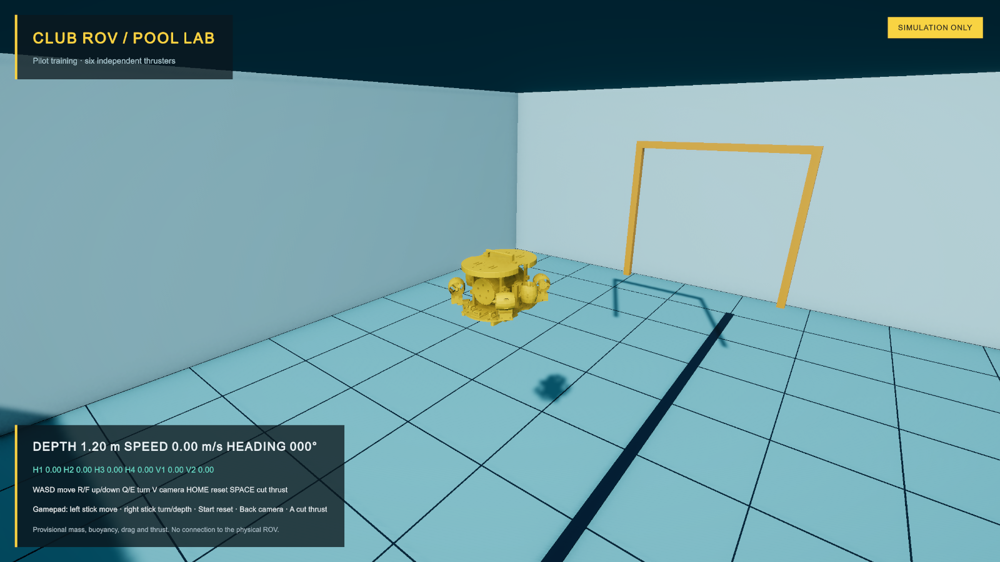

# Club ROV simulator

I am building this Unity prototype as a pool-training and sensor-experiment environment for the club ROV. It uses the existing assembly viewing mesh, a six-thruster force model and a simple pool with a practice gate.

Editor: **Unity 6000.6.7f1**. Render pipeline: **URP 17.6.0**. Input: **Unity Input System 1.20.1**. The approved Unity Pipeline package provides local Editor automation; no cloud project is required.

## Run it

1. Add this folder to Unity Hub as an existing project and open it with the matching Editor.
2. Open `Assets/Scenes/PoolTraining.unity`.
3. Press Play, then click the Game view to give it keyboard/controller focus.

The validated local Windows build is in `Builds/Windows/ClubROVSim.exe`. Keep the entire Windows folder together when copying it. Build output is excluded from Git.

Keyboard controls:

- **W/S:** forward/backward.
- **A/D:** move sideways.
- **R/F:** ascend/descend.
- **Q/E:** turn left/right.
- **V:** switch between chase and onboard camera views.
- **Home:** reset position, orientation, velocity and thruster commands.
- **Space:** cut simulated thrust. The vehicle still has inertia.

Gamepad controls: left stick moves horizontally; right stick controls yaw and vertical thrust; Start resets; Back/Select switches camera; A/south button cuts thrust. These bindings are implemented, but have not been verified with a physical gamepad. Losing application focus clears pilot thrust commands.

## What the model does

Four angled horizontal thrusters supply surge, sway and yaw. Two vertical thrusters supply heave. Each command becomes a force at an individual body-space position, with a simple response delay and reduced reverse thrust. The rigid body also receives gravity, buoyancy, quadratic linear drag and angular damping. An offset center of buoyancy gives passive roll/pitch stability.

The HUD shows simulated depth, speed, heading and all six normalized thruster-force commands. The mixer accounts for the weaker reverse limit before applying force, so that yaw and sideways commands do not create unwanted translation. These are force fractions, not PWM/DShot values. The H1–H4/V1–V2 labels are local simulation identifiers; they are not a verified ArduSub channel mapping.

Units are metres, kilograms, seconds and newtons. Unity axes are +Z forward, +X starboard and +Y up. The mesh importer converts the source CAD millimetres and centers the visual mesh. The imported visual bounds are approximately 0.38 × 0.26 × 0.36 m. A box collider approximates the hull; it does not reproduce every rail or thruster guard.

The current live Fusion dimensions, six thrust-axis locations and mounting angles are recorded in [Fusion geometry](Docs/FUSION_GEOMETRY.md). My printed parts use Bambu Lab PETG Basic at 100% infill. This snapshot is available for the next dynamics update; it has not yet replaced the prototype's actuator locations.

## Provisional parameters

I still need measurements from the real ROV. The initial values are **8 kg mass**, **0.008 m³ displacement**, **1000 kg/m³ water density**, **15 N full forward thrust per motor**, **0.8 reverse ratio**, **0.15 s response** and **35 mm buoyancy offset**. Angular speed is capped at **1.2 rad/s** for the starter training setup. These are starting values, not measured U01 performance or a verified vehicle mass. Drag, thrust locations, inertia and collider geometry also need calibration.

The initial displacement makes the 8 kg rigid body neutrally buoyant when fully submerged. An approximate submerged fraction reduces buoyancy and thrust near the flat water surface. There is no tether model, added mass, wave model, realistic sonar, sensor-noise model or photorealistic underwater optics yet.

## Source layout

- `Assets/ROV/Scripts/RovDynamics.cs`: buoyancy, drag and six actuator forces.
- `RovThrusterLayout.cs`: provisional force locations/directions and normalized mixer.
- `RovPilotInput.cs`: keyboard/gamepad input, separated from physics for later integration.
- `RovCameraRig.cs`: chase/onboard camera selection.
- `Assets/ROV/UI/`: UI Toolkit HUD and display logic.
- `Assets/ROV/Editor/PoolSceneBuilder.cs`: repeatable scene creation, STL conversion and mixer checks. It refuses to overwrite an existing PoolTraining scene.
- `RovSmokeChecks.cs`: bounded Play Mode checks that restore the vehicle and input afterward.
- `Docs/AI/UnityProjectContext.md`: project conventions and tooling context.

The generated mesh and scene are included, so opening this project does not require a CAD importer. Rebuilding the visual mesh uses `../../Models/club-rov-preview.stl` from the parent ROV repository. The source assembly predates the newest mechanical changes; commercial reference geometry keeps its existing [attribution](../../Documentation/PUBLISHING.md).

## Validation and next steps

The initial scene compiled in the live Editor and the six mixer checks passed. See [validation notes](Docs/VALIDATION.md) for the runtime checks and remaining limits.

This prototype is isolated from the real ROV. It does not connect to the ESP32, ARK, QGroundControl, ArduSub SITL or ROS 2. My next stages are to tune the vehicle dynamics, verify physical controller input, add simulated sensor interfaces and then integrate ArduSub SITL/ROS 2 with explicit command ownership.
