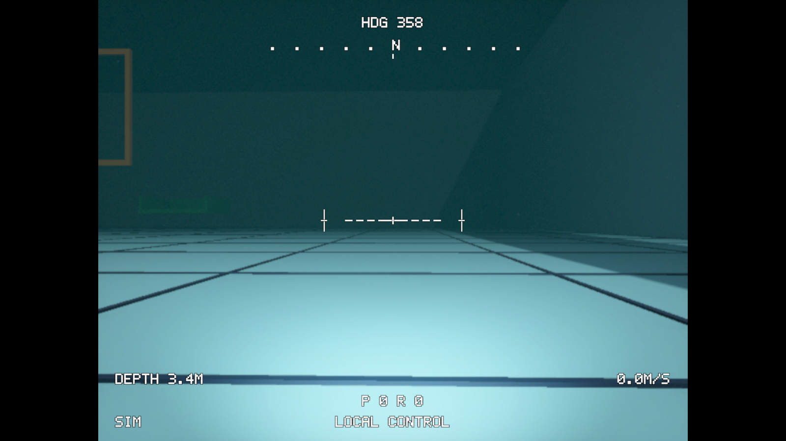

# Club ROV simulator

ClubROVSim is a Windows desktop training simulator for the club's six-thruster ROV. It supports local keyboard/controller practice and an optional ArduSub SITL connection through QGroundControl. Six training maps, adjustable water conditions, three camera views and selectable FPV instruments are included in one Unity scene.

The vehicle envelope and thruster locations come from a Fusion geometry snapshot. Mass, buoyancy, drag and thrust remain provisional; simulator results do not establish the physical ROV's performance or competition readiness.



FPV with Betaflight-style instruments and the large panels hidden. Instrument styles can be switched during practice.

## Start local practice

**From a Windows practice package:** extract the entire ZIP, then run `ClubROVSim.exe` or the included `Start-Practice.bat` for a 1280 × 720 window. Keep the executable, data directory and DLLs together. Local practice does not require Unity, Python, WSL or QGroundControl. See the [portable quickstart](Docs/PRACTICE_QUICKSTART.txt).

**From source:**

1. Add this `ClubROVSim` folder to Unity Hub as an existing project.
2. Open it with **Unity 6000.6.7f1**.
3. Open [PoolTraining.unity](Assets/Scenes/PoolTraining.unity), press Play and click the Game view for input focus.
4. Use local controls immediately, or choose a map under **TRAINING CONDITIONS & SCENARIOS** and select **LOAD MAP & RESET START**.

The project uses **URP 17.6.0**, **Input System 1.20.1** and UI Toolkit. The existing Unity Pipeline package supports local Editor automation; running the simulator does not require a cloud project.

Compiled players and practice ZIPs under `Builds/` are local generated outputs and are **not included in a Git clone**. Build from source or obtain a complete practice package from the club.

## Controls

Local vehicle controls:

- **W/S**, **A/D**, **R/F**: forward/back, sideways and ascend/descend.
- **Q/E**: turn left/right.
- **Space**: cut thrust while held; existing momentum remains.
- **Home**: reset the vehicle pose, velocity, thrust and course progress.
- **Xbox/controller left stick**: horizontal movement.
- **Right stick**: yaw and vertical movement.
- **A / south button**: cut thrust while held. **Start**: reset.

View and display controls:

- **V / Back or Select**: cycle **Chase → FPV → Top-down**. The **CAMERA** button does the same.
- **H / right-stick click**: hide or restore the large telemetry/settings panels and their buttons. FPV instruments remain independently visible.
- **O / left-stick click**: show or hide FPV instruments.
- **I**: cycle the three instrument styles, including while panels are hidden.
- Each panel's title button minimizes or restores that panel. Use **H and O** for completely clear FPV video.

Click away from text fields and dropdowns to return keyboard focus to piloting. Losing application focus clears local thrust commands. Panel visibility lasts for the current session; instrument style and graphics preferences are saved locally.

Local pilot defaults are a **0.15 dead zone**, **0.65 translation sensitivity**, **0.50 yaw sensitivity** and **0.60 thrust limit**. To tune them, select **Club ROV - simulation** and edit **Rov Pilot Input** before entering Play Mode. Keyboard movement uses the same sensitivity and limit without the stick dead zone. The limit scales mixed actuator commands together to preserve balance.

When SITL is connected, QGroundControl owns vehicle commands. Unity's local movement, thrust-cut and reset bindings are not the autopilot controls; use QGC to pilot and disarm. Unity still controls the camera and display.

## Training maps

Select **Training map**, then **LOAD MAP & RESET START**. Map/start changes require disconnecting SITL and restarting the SITL session after the new start is applied.

- **Pool course:** three gates, a cyan hover target and a green docking bay.
- **Gate & pillar:** pass beneath a 2 m bar at 1 m depth, circle the marker 10 m beyond it, then return beneath the bar. The start is 3 m behind the gate. Either orbit direction works; a surface breach invalidates score eligibility. This is a prequalification practice approximation.
- **Empty pool:** free piloting and tuning without scored completion.
- **Slalom:** five offset gates at varying depths, then hover and dock.
- **RoboSub 2026 practice:** handbook practice-field arrangement with static task stations and official task artwork.
- **RoboSub 2026 finals:** handbook finals-field arrangement with static task stations and official task artwork.

The first four maps use a **20 × 24 m pool, 3.5 m deep**. The two handbook maps use a separate **50 × 22.86 m arena, 2.1 m deep**. All layouts share the same scene; inactive layouts may still occupy memory.

The handbook maps are **unscored exploration layouts**. Task spacing is estimated from diagrams marked not to scale; acoustic sensing, torpedo firing, marker drops and object handling are not implemented. Their source drawings, artwork provenance and approximations are documented in [RoboSub 2026 maps](Docs/ROBOSUB_2026_MAPS.md). Simulator completion is not official prequalification or proof of autonomy.

### Original pool course

Cross the three yellow gates in order toward +Z. Cyan pips identify each gate; backward crossings or crossings outside the inset opening do not score. The HUD shows the next target's distance, bearing and depth.

After gate 3, hold in the cyan target for **3 continuous seconds**, within **0.45 m**, heading **000° ±15°**, below **0.15 m/s**. Then hold in the green dock for **3 seconds**, within **0.40 m horizontally / 0.18 m vertically**, heading **180° ±15°**, below **0.10 m/s**. Leaving a target's limits restarts its hold.

The timer starts with movement and freezes on completion. Collisions count contact entries with a 0.4 s debounce. **Restart Course**, **Home** or controller **Start** resets local course progress.

## Water conditions and scenarios

**TRAINING CONDITIONS & SCENARIOS** provides normal-pool, cross-current, murky-water and H2-failure presets. Conditions include current up to **1 m/s**, buoyancy bias **±10%**, single-thruster health **0–100%**, visibility, suspended particles, spotlight and video delay. These are training disturbances rather than measured pool conditions.

Visibility ranges from **1–20 m**, with an **8 m** default. It adjusts underwater fog and tint; the selected distance is an artistic contrast range, not calibrated turbidity. Fog disables above the surface.

**SAVE / REPLACE** saves the current conditions, selected map, vehicle position and heading. Up to twelve custom scenarios are stored in `Application.persistentDataPath/training-scenarios.json`; an existing name is replaced. Presets preserve the selected map and reset its start. Unsupported or corrupt save files are preserved, with errors shown in the HUD. Previous saves are backed up.

Conditions can be adjusted during SITL practice, but changing the map or start pose requires disconnecting and restarting SITL. Changing conditions or control mode during a scored run marks it **PRACTICE**.

## Cameras and FPV instruments

**Chase** provides a third-person view. **Top-down** is north-up and orthographic. **FPV** approximates the Pi Camera 2 feed: **640 × 480**, **4:3**, up to **30 samples/s**, and a **48.8° vertical field of view**, with softness, grain, color quantization and block variation. These effects are artistic approximations of onboard video.

Optional **0–500 ms video delay** affects only the camera image. It warms up after changing the delay; controls, telemetry and instruments remain live. FPV resources are released when leaving FPV.

The **Instrument style** selector under **CONTROL & SETTINGS**, or **I**, switches between:

- **Compact dials:** corner attitude and compass gauges; the default.
- **Flight overlay:** central artificial horizon, pitch ladder and heading tape.
- **Betaflight-style OSD:** outlined fixed-cell text, segmented horizon, compass and edge readouts.

**FPV INSTRUMENTS**, **O** or **left-stick click** controls visibility independently of the large panels. Instruments appear only in FPV and render at native display resolution, separately from the sampled video. Positive pitch is nose-up, positive roll is right-bank, and north is world +Z. Heading is undefined when pointing exactly vertically.

Instrument values come directly from simulation truth. No separate AHRS estimator or magnetic sensor is modeled. The Betaflight-style lettering and graphics are an original implementation; firmware/font assets are not bundled.

## ArduSub and QGroundControl

The optional integration runs **ArduSub 4.7.2**, six-motor **VECTORED**, with MAVLink system ID **42**. Unity provides physics and sensor data; the autopilot provides actuator commands. This is separate from the physical ARK and ROV.

1. Complete the prerequisites in the [SITL guide](../SITL/README.md): WSL2/Ubuntu, the pinned ArduSub setup, Python 3 and PowerShell 7.
2. Start the Unity scene, select the map/start, then run [Start-ClubRovSitl.bat](../SITL/Start-ClubRovSitl.bat). On the configured desktop it connects the running Unity Editor automatically. For a standalone player, launch `Start-ClubRovSitl.ps1` without `-ConnectUnityEditor`, then use **CONNECT SITL** at `127.0.0.1`; the `.bat` always requests Editor auto-connect.
3. In QGC, connect a TCP communication link to **127.0.0.1:5765** and confirm **vehicle ID 42**. Configure the joystick in QGC and **arm** before expecting thrust.
4. Disarm in QGC before stopping. Press Enter in the launcher to stop its helpers; **DISCONNECT SITL** restores local Unity controls.

Only one control path owns thrust at a time. A link timeout clears thrust and holds SITL physics until an explicit reconnect. Restart SITL and reconnect after a map/start change, reset, Editor pause/recompile or lost link. The badge shows **LOCAL CONTROL**, **ARMED**, **DISARMED** or **ARM STATE UNKNOWN**; stale heartbeat status becomes unknown.

Hands-on manual control, depth hold and heading hold were confirmed. Absolute depth calibration, autopilot tuning and camera streaming into QGC remain unvalidated. The launcher, network ports, setup and detailed evidence are in the [SITL guide](../SITL/README.md).

## Run feedback and graphics

Scored courses record elapsed simulation time, collisions, depth RMS error and heading RMS error. Scores start at 1000, subtract **2 per second**, **50 per collision**, **100 per metre of depth RMS error** and **2 per degree of heading RMS error**, and stop at zero. Only completed runs with unchanged conditions update personal bests; bests are separated by map, conditions and local/SITL mode.

`training-runs.json` under `Application.persistentDataPath` retains the latest 100 completed runs and up to 256 condition/mode bests. Empty-pool and handbook-map exploration do not produce scored completion.

The **VEHICLE & GRAPHICS** panel offers **Low / Medium / High** and **30 / 60 / 120 FPS** caps. **Medium / 60** is the default. Presets use **65 / 85 / 100%** render scale and **0 / 15 / 30 m** shadow distance; HDR is enabled on High. They change rendering, not physics or scenario conditions. Displayed FPS is a rolling rendering measurement; FPV sampling remains capped separately. Minimum hardware requirements have not been established.

## Physics and calibration limits

Four horizontal thrusters provide surge, sway and yaw; two vertical thrusters provide heave. Forces act at individual measured thrust-axis locations, with response delay, reduced reverse thrust, gravity, buoyancy, quadratic drag and angular damping. An offset center of buoyancy provides passive roll/pitch stability.

Current scene values are **8 kg mass**, **0.008 m³ displacement**, **1000 kg/m³ water density**, **15 N full forward thrust per motor**, **0.8 reverse ratio**, **0.15 s response** and **35 mm buoyancy offset**. Angular speed is capped at **1.2 rad/s**. These are provisional settings, not measured vehicle performance.

The [Fusion snapshot](Docs/FUSION_GEOMETRY.md) supplies a **361.920 × 377.472 × 260.000 mm length/width/height envelope** and six thrust-axis lines. A box collider approximates that envelope. The geometric center is the provisional reference, not a measured center of mass. The viewing mesh predates later mechanical revisions; all printed parts are specified as Bambu Lab PETG Basic at 100% infill.

Unity uses metres, kilograms, seconds and newtons, with **+Z forward, +X starboard, +Y up**. The HUD's H1/H2/H3/H4/V1/V2 values are normalized simulated force fractions, not PWM/DShot outputs or verified physical wiring labels.

There is no tether model, added mass, wave solver, realistic sonar or calibrated sensor-noise/underwater optics model. Mass, inertia, balance, displacement, drag and thrust need measurements from the assembled ROV. ROS 2 and real-hardware connections are not implemented.

## Build and share

Use Unity's Build Profiles to build **Windows x64** with `Assets/Scenes/PoolTraining.unity` enabled and save the executable as `Builds/Windows/ClubROVSim.exe`. Then, from this project folder, run:

```powershell
pwsh -NoProfile -ExecutionPolicy Bypass -File ./Package-Practice.ps1
```

The [packager](Package-Practice.ps1) writes `Builds/Practice-<timestamp>.zip` directly, with the complete player, quickstart and windowed launcher. Unity backup/debug directories are excluded. The ZIP supports local practice; SITL tools and dependencies are separate. Mac/Linux require separate builds. Generated players and ZIPs stay out of Git.

## Code and validation

Start with these source files:

- [RovPilotInput.cs](Assets/ROV/Scripts/RovPilotInput.cs): local keyboard/gamepad input and tuning.
- [RovDynamics.cs](Assets/ROV/Scripts/RovDynamics.cs) and [RovThrusterLayout.cs](Assets/ROV/Scripts/RovThrusterLayout.cs): forces, buoyancy, drag and actuator allocation.
- [RovTrainingMaps.cs](Assets/ROV/Scripts/RovTrainingMaps.cs), [RovTrainingCourse.cs](Assets/ROV/Scripts/RovTrainingCourse.cs) and [RovTrainingSettings.cs](Assets/ROV/Scripts/RovTrainingSettings.cs): maps, objectives and conditions.
- [RovTrainingData.cs](Assets/ROV/Scripts/RovTrainingData.cs): scenario/run persistence.
- [RovCameraRig.cs](Assets/ROV/Scripts/RovCameraRig.cs), [RovFpvCameraFeed.cs](Assets/ROV/Scripts/RovFpvCameraFeed.cs) and [RovFpvRendererFeature.cs](Assets/ROV/Scripts/RovFpvRendererFeature.cs): views and the sampled FPV feed.
- [UI](Assets/ROV/UI/): UI Toolkit panels, graphics settings and FPV instruments.
- [RovSitlBridge.cs](Assets/ROV/Scripts/RovSitlBridge.cs) and [RovSitlProtocol.cs](Assets/ROV/Scripts/RovSitlProtocol.cs): simulation ownership, actuator packets and sensor replies.
- [Editor](Assets/ROV/Editor/): scene/layout installers and bounded checks. Scene creation refuses to overwrite the existing training scene.
- [Project context](Docs/AI/UnityProjectContext.md): architecture, conventions and tooling.

The scene and viewing mesh are included; normal opening does not require a CAD importer. Rebuilding the mesh uses [club-rov-preview.stl](../../Models/club-rov-preview.stl). Commercial reference geometry retains its [attribution](../../Documentation/PUBLISHING.md).

The [validation record](Docs/VALIDATION.md) documents mixer, movement, input, course, map, artwork, FPV, panel and instrument checks, Windows build results and remaining limits. The [SITL record](../SITL/README.md#validation) covers protocol and live autopilot checks. These dated checks are not a claim that every feature has been retested on every computer or that the real vehicle is calibrated.
